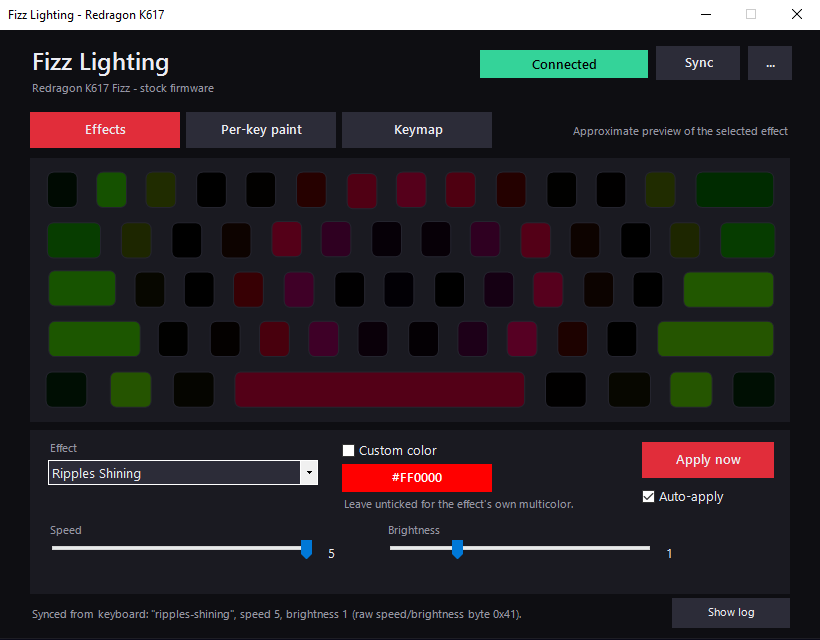
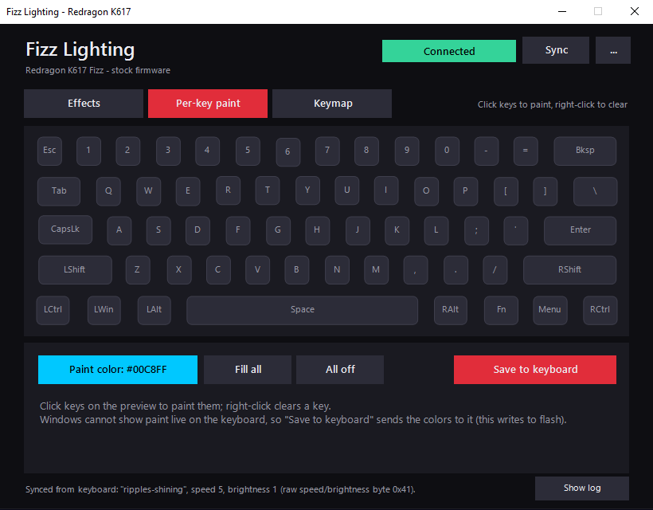
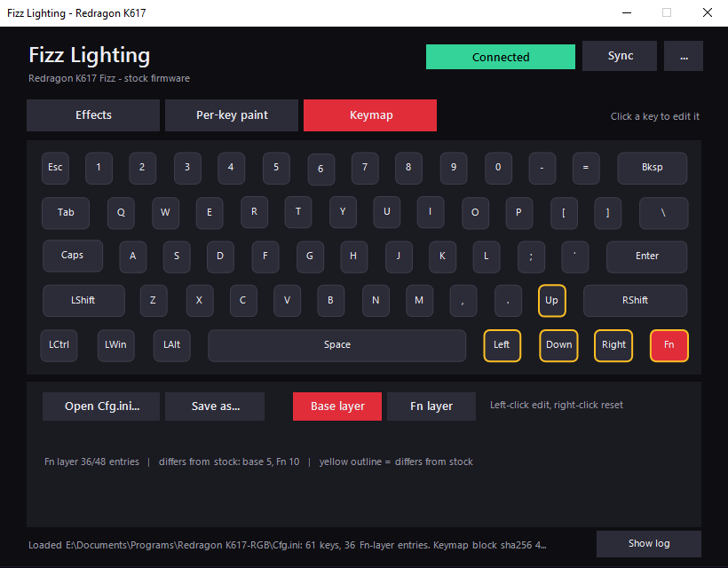
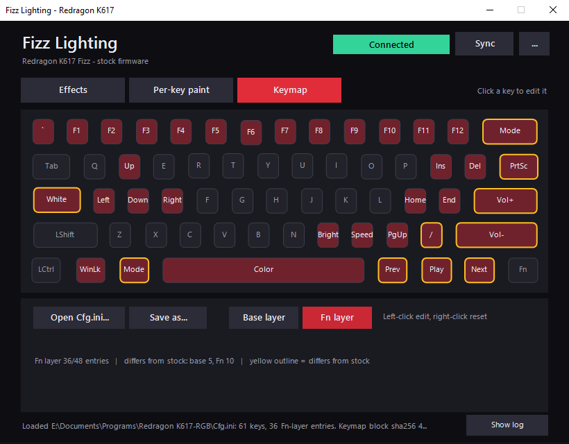

# Fizz Lighting

Lighting and keymap tool for the **Redragon K617 Fizz** keyboard (stock firmware).
One PowerShell file, no install, no drivers.

## Screenshots

### Effects


### Per-key paint


### Keymap editor — Base layer


### Keymap editor — Fn layer


> **Made entirely by AI.** This project was designed and written by Claude (Anthropic's AI
> assistant) in a long chat session with a human who supplied the hardware, direction and testing.
> Nobody wrote the code by hand. See [How this was made](#how-this-was-made) for what that means
> and how it was checked. It writes to your keyboard's flash memory, so read the
> [safety notes](#what-it-writes-to-your-keyboard) first.

## Features

- **Effects** - all 22 built-in lighting effects with speed, brightness and custom color,
  applied straight to the keyboard. Controls follow what each effect actually supports.
- **Animated preview** - a 61-key preview that animates the selected effect. It is an
  *approximation* of the firmware's animations, not an exact copy.
- **Sync from keyboard** - reads the keyboard's current effect, speed, brightness and color and
  shows them in the controls.
- **Auto-apply** (optional) - applies about 0.7 s after you stop changing something.
- **Per-key paint** - paint individual keys on the preview and save the result to the keyboard.
- **Keymap editor (offline)** - edit the base layer and the Fn layer of the Redragon `Cfg.ini`
  on a visual keyboard, with validation, then save a new `Cfg.ini`.
- Tools menu with connection diagnostics, copyable log and a dry-run mode that sends nothing.

## Requirements

- Windows with Windows PowerShell 5.1 (built in on Windows 10/11).
- A Redragon K617 Fizz with USB ID `258A:0049` and the **stock firmware** (the classic
  hot-swap model; the magnetic version is not supported).
- Close Redragon's own software while using this tool - only one program can talk to the keyboard.

## Quick start

Fizz Lighting can be launched directly from GitHub or run locally. Both methods use the same PowerShell application.

### Option 1: Run directly from PowerShell (recommended)

No manual download or extraction required.

1. Connect your Redragon K617 Fizz keyboard.
2. Open **Windows PowerShell**.
3. Copy and execute:

```powershell
irm https://raw.githubusercontent.com/irm-synth/fizz-lighting/refs/heads/main/fizz-gui.ps1 | iex
```

PowerShell retrieves the latest `fizz-gui.ps1` from the repository's `main` branch and executes it in the current PowerShell session.

**Important:**
- This method requires an internet connection.
- It executes the downloaded script directly.
- Review the script before executing it if you want to inspect what will run.
- Because it uses the `main` branch, the version can change whenever the repository is updated.

### Option 2: Run locally

1. Download the latest **Release**.
2. Extract the archive.
3. Double-click `Fizz-Lighting.cmd`.
4. The application connects to the keyboard and displays its current lighting settings.

The local launcher starts PowerShell with the required STA mode.

### Keymap configuration

The keymap editor can open an existing Redragon `Cfg.ini` using the **Open Cfg.ini...** button.

For local execution, you can also place a copy named `Cfg.ini` next to `fizz-gui.ps1` for automatic loading.

When running directly from GitHub, use **Open Cfg.ini...** to select the configuration manually.

## What it writes to your keyboard

- **Effects** (Apply, or Auto-apply) and **Save to keyboard** in the paint tab write lighting
  settings to the keyboard's flash. They only touch lighting data, never the keymap or firmware.
  Flash has a limited number of write cycles; auto-apply waits for you to stop changing things and
  skips writes that would change nothing, but don't leave a slider wiggling on purpose.
- The **Keymap tab never writes to the keyboard.** It saves a `Cfg.ini` file; you apply it with the
  Redragon software's RESTORE button (keep a backup of your original `Cfg.ini`).
- The keyboard's own factory reset (hold Fn+Esc) is not affected by this tool.
- Everything this tool sends can be previewed with *Dry run* in the `...` menu.

## Known limitations

- **No live preview on the keyboard.** Windows rejects the report the keyboard uses for live
  painting (it is not declared in the HID descriptor; Linux does not check). Paint is saved to the
  keyboard instead.
- Preview animations are approximations.
- fizzctl verified the custom-color position for only three effects; the rest use the same
  per-effect record layout, which fits all three verified points (see `docs/PROTOCOL.md`).
- The keymap editor handles one key per Fn-layer entry; macros are not supported.
- Tested on one keyboard and one PC. Other Redragon boards sharing the same USB ID are untested.

## How this was made

Claude (an AI model made by Anthropic) wrote all of the code, tests and documentation from
conversations with the repository owner, who provided the keyboard, decided what to build and
tried the results on real hardware. The USB protocol itself is **not** AI-invented: it comes from
[fizzctl](https://github.com/ayoubdya/fizzctl) (see [Credits](#credits)).

AI-written code can contain mistakes, so it was checked in several ways:

| Check | What it proves |
|---|---|
| Frame bytes compared with fizzctl (`dev/reference`, 5,088 cases) | The data sent to the keyboard matches the original implementation |
| Logic tests (`dev/tests/run-logic-tests.ps1`) | Sync decoding, color placement, animation engine, settings, Cfg.ini handling |
| Scripted GUI session (`dev/tests/run-ui-test.ps1`) | Every tab and button works against a stand-in WinForms library and a fake keyboard |
| Hands-on testing by the owner | See the table below |

| Feature | Automated tests | Tried on real hardware |
|---|---|---|
| Apply an effect | yes | yes |
| Save painted keys | yes | yes |
| Custom color on every color-capable effect | yes (placement rule) | _update after testing_ |
| Sync from keyboard | yes (fake device) | _update after testing_ |
| Auto-apply | yes (fake device) | _update after testing_ |
| Keymap editor / saving a Cfg.ini | yes | _update after testing_ |

## Credits

- **[fizzctl](https://github.com/ayoubdya/fizzctl)** (MIT) - the reverse-engineered protocol this
  tool is built on: report sequences, captured frames, effect tables, keymap encoding. Required
  reading: `THIRD-PARTY-NOTICE.txt`.
- [octenite/redragonKB-remap](https://github.com/octenite/redragonKB-remap) - community documentation
  of the Redragon `Cfg.ini` format and function codes.
- [thatsdai00/redragon-k617-productivity](https://github.com/thatsdai00/redragon-k617-productivity) -
  an earlier toolkit for this keyboard; inspiration for the window style. No code is included.
- carlossless's [smk](https://github.com/carlossless/smk) and
  [sinowisp](https://github.com/carlossless/sinowisp) - firmware tooling explored during
  development; not used by this tool.

## Disclaimer

Not affiliated with or endorsed by Redragon. "Redragon" and "K617 Fizz" are used only to say which
hardware this works with. The keyboard protocol is reverse-engineered and unofficial. This software
is provided as is, without warranty, and you use it at your own risk.

## License

MIT - see `LICENSE`. Third-party notices: `THIRD-PARTY-NOTICE.txt`.
